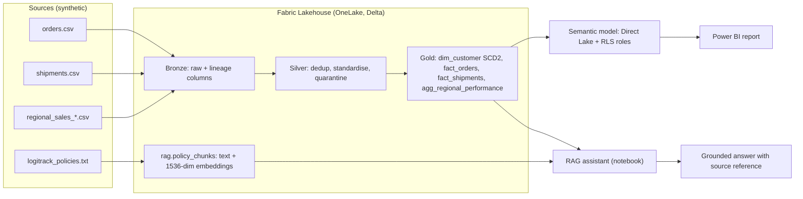

# LogiTrack: A Governed Data Platform on Microsoft Fabric, with a Grounded GenAI Assistant

An end-to-end data engineering project built on **Microsoft Fabric**. It takes messy logistics data from several sources, cleans and models it through a medallion architecture, secures it, reports on it, promotes it across environments, and lets people ask questions about it in plain English, with answers grounded in governed data and company policy documents.

The company (LogiTrack) and all data are **synthetic**. The engineering problems are the ones a real data team faces.

> Author: Sahil Gaikwad · Built September 2026 · Fabric F2 capacity, Central India region

---

## What this project demonstrates

| Area | What was built |
|---|---|
| Ingestion | Raw CSV sources landed as Delta tables with lineage columns (`_ingested_at`, `_source_file`, `_source_system`) |
| Data quality | Deduplication, region and date standardisation, and a **quarantine** pattern that keeps rejected rows with a reason instead of deleting them |
| Modelling | Star schema in the Gold layer, including a **Slowly Changing Dimension Type 2** customer dimension |
| Reporting | Power BI report on a **Direct Lake** semantic model (no data copy, no refresh schedule) |
| Governance | Four **row-level security** roles (one per region) and Fabric's built-in item lineage |
| Cost awareness | Capacity Metrics monitoring, plus an incremental-load rewrite of the ingestion notebook |
| GenAI | A **RAG** assistant that answers from policy documents and Gold-layer numbers, and declines when the data does not contain the answer |
| Delivery | A Dev → Test → Production **deployment pipeline**; Git integration steps documented |

## Architecture



Full detail, including the star schema and environments, is in [docs/architecture.md](docs/architecture.md).

## Results (measured in this project)

| Layer | Result |
|---|---|
| Bronze | 1,028 order rows, 944 shipment rows, 48 regional-sales rows landed |
| Silver: orders | 28 exact duplicates removed, 61 rows quarantined, **939** clean rows |
| Silver: shipments | 19 exact duplicates removed, 0 quarantined, **925** clean rows |
| Gold | 287 customers in `dim_customer`; 939 `fact_orders`; 925 `fact_shipments`; 4-row regional aggregate |
| Report | $359,476.84 total revenue across 939 orders. By region: North $109,100, South $97,979, East $83,279, West $69,118 |
| Governance | 4 RLS roles defined; filter logic validated by DAX query (East = 216 orders, matching the aggregate) |
| Cost | Notebook runs were ~85% of capacity compute over 14 days (14,261 of 16,867 CU-seconds). Incremental ingestion: 25.7 s for the initial 3-table load vs 2.8 s for a no-new-data check on one table (see caveat in [case study](docs/case-study.md#5-cost-and-performance)) |
| GenAI | 17 policy chunks embedded (1,536 dimensions); 3 of 3 test questions answered from the supplied context, including one correct refusal |
| Delivery | Development, Test and Production stages all deployed successfully |

## Example: the assistant refusing to guess

**Question:** *What's our average delivery delay for the East region, and what's our policy on delayed shipment refunds?*

The assistant answered the policy half from the retrieved text (50% shipping refund once a delayed order is 5 business days past its estimate, credited automatically within 3 business days) and said plainly that the data holds *average delivery days* (5.19 for East) but not *delay beyond the promised window*, so the delay figure could not be answered. It did not invent a number.

**Question:** *Which region has the highest revenue, and what's the return window for office furniture?*

It combined a structured answer from Gold (North, $109,100.15) with an unstructured one from the policy text (14 days, plus a 15% restocking fee if assembled).

More in [docs/case-study.md](docs/case-study.md#6-genai-rag-assistant).

## Repository structure

```
.
├── README.md
├── LICENSE
├── .gitignore
├── data/
│   ├── generate_data.py            # creates the messy sample data (seeded)
│   ├── sample/                     # the exact files loaded into Fabric
│   └── policies/                   # shipping and refund policy text (RAG source)
├── notebooks/                      # plain-Python copies of the Fabric notebook cells
│   ├── 01_bronze_ingestion.py
│   ├── 01b_bronze_ingestion_optimized.py
│   ├── 02_silver_cleaning.py
│   ├── 03_gold_modeling.py
│   ├── 04_genai_rag_chatbot.py
│   └── utils/check_region_whitespace.py
├── powerbi/
│   └── LogiTrack_Professional_Theme.json   # for use in Power BI Desktop
├── fabric/                         # folder Fabric Git integration commits into
└── docs/
    ├── architecture.md
    ├── case-study.md
    ├── data-dictionary.md
    ├── setup-guide.md
    ├── git-integration.md
    └── images/                     # screenshots (see images/README.md)
```

## Reproducing it

Follow [docs/setup-guide.md](docs/setup-guide.md). In short: create a Fabric capacity and workspace, create a schema-enabled Lakehouse, upload the sample files, run notebooks 01 → 04 in order, build the semantic model and report, then create the deployment pipeline.

## Known limitations

These are stated up front because they matter more than the polish:

- **Synthetic, small data.** Volumes are about a thousand rows per table, so cost and speed figures are illustrative, not benchmarks.
- **SCD Type 2 update path is untested.** The initial load was run and verified. The merge branch that expires and inserts changed customers is written but has not been exercised with a real change.
- **RLS is defined but not end-to-end tested.** The four roles exist with no members assigned. Fabric's "Test as role" failed on this Direct Lake model because of single sign-on, so the filter logic was validated with a direct DAX query only.
- **No like-for-like cost baseline.** The original ingestion notebook's runtime was not captured, so the optimisation is demonstrated rather than rigorously benchmarked.
- **Lineage is Fabric-native and item-level.** Microsoft Purview is not integrated.
- **AI cross-region processing was enabled** (a tenant setting) because the capacity is in India. Fine for synthetic data; it would need a compliance review for real data.
- **Deployment pipeline promotes item definitions, not Lakehouse data.** The Test and Production workspaces need their own data loads.
- **The report is functional, not polished.** A Power BI Desktop redesign using the included theme is planned.

## Roadmap

- Connect Git integration and work on feature branches ([docs/git-integration.md](docs/git-integration.md))
- Exercise and unit-test the SCD2 update path
- Assign RLS members and test with a second user
- Add streaming (GPS pings via Eventstream and a KQL database)
- Add data-quality dashboards driven by the quarantine tables
- Redesign the report in Power BI Desktop

## Licence

MIT. See [LICENSE](LICENSE).
