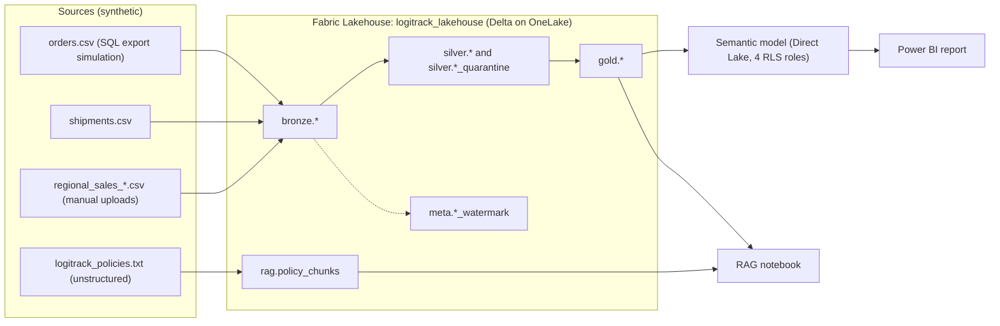
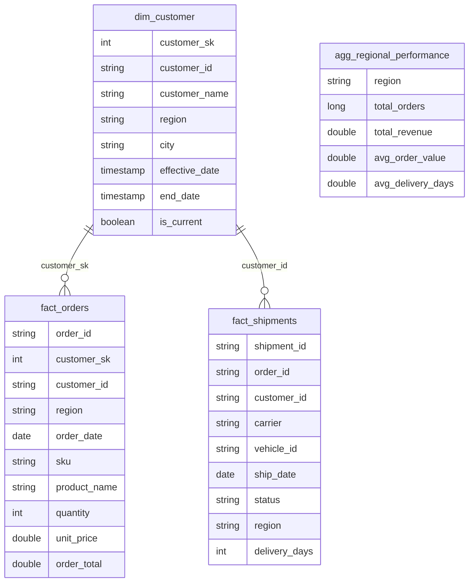
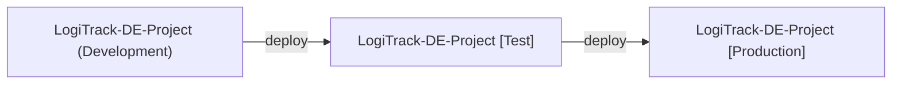

# Architecture

## 1. Logical flow

## 2. Layers

| Layer | Schema | Purpose | Key behaviours |
|---|---|---|---|
| Bronze | `bronze` | Capture source data as-is | Adds `_ingested_at`, `_source_file`, `_source_system`; overwrite load; schema inferred |
| Bronze v2 | `bronze_v2` | Optimised ingestion | Explicit schema; watermark table so only new files are read |
| Silver | `silver` | Trusted, standardised rows | Exact-duplicate removal; region trimmed and title-cased; four date formats parsed to `DATE`; rows failing rules go to `*_quarantine` with `_quarantine_reason` |
| Gold | `gold` | Business-ready model | Star schema; SCD2 customer dimension; pre-aggregated regional table for the report |
| RAG | `rag` | Vector store | Policy paragraphs plus 1,536-dimension embeddings stored as a Delta table |
| Meta | `meta` | Pipeline state | One watermark table per source, listing processed files |

## 3. Gold star schema

`agg_regional_performance` is a standalone pre-aggregation with no relationships. It exists so the report's KPI cards and region chart read a four-row table.

**Design note:** `fact_orders` joins to the dimension on the surrogate key, while `fact_shipments` joins on `customer_id`. That works today because each customer has one dimension row. Once SCD2 produces several versions per customer, `fact_shipments` should be moved to a surrogate key too.

## 4. Consumption

- **Power BI:** a Direct Lake semantic model over the four Gold tables, with relationships as above. The report reads Delta files directly, so there is no import and no refresh schedule.
- **Row-level security:** roles `East_Region_Rep`, `West_Region_Rep`, `North_Region_Rep`, `South_Region_Rep`. Each applies `[region] = "<Region>"` to `fact_orders`, `fact_shipments` and `agg_regional_performance`.
- **RAG assistant:** a notebook that embeds the question, ranks policy chunks by cosine similarity, adds the regional figures from Gold as text, and asks the model to answer from that context only.

## 5. Environments

A Fabric deployment pipeline (`LogiTrack-DE-Pipeline`) promotes the Lakehouse, notebook, semantic model and report. It copies item **definitions**, not the data inside the Lakehouse, so each stage needs its own data load. Git integration is intended for the Development workspace only (see [git-integration.md](git-integration.md)).

## 6. Platform and capacity

| Item | Value |
|---|---|
| Capacity | Fabric F2, created through Azure, Central India |
| Storage | OneLake, Delta format |
| Compute | Spark notebooks (Fabric default pool) |
| Monitoring | Microsoft Fabric Capacity Metrics app |
| AI access | `openaivec` with `setup_fabric()`, using Fabric's built-in Azure OpenAI access billed to the capacity |

## 7. Why these choices

| Decision | Reason | Trade-off |
|---|---|---|
| Quarantine tables instead of deleting bad rows | Keeps an audit trail and lets the business fix the source | Extra tables to monitor |
| Lakehouse as the vector store | No extra service to provision or pay for | Cosine similarity is computed in pandas, which will not scale to millions of chunks |
| Direct Lake | No data duplication or refresh scheduling | Some features (such as "Test as role") behave differently |
| Fabric AI functions rather than a separate Azure OpenAI resource | The Azure for Students subscription's allowed-regions policy rejected the East US deployment. Rather than search its allowed list for a region that offers Azure OpenAI, this route uses capacity that was already provisioned | Requires enabling cross-region processing; prompts may be processed outside the capacity's region |
| Schema-qualified tables (`bronze.orders`) | Clear medallion boundaries in a schema-enabled Lakehouse | A newer Lakehouse option; check its current support status before relying on it |
